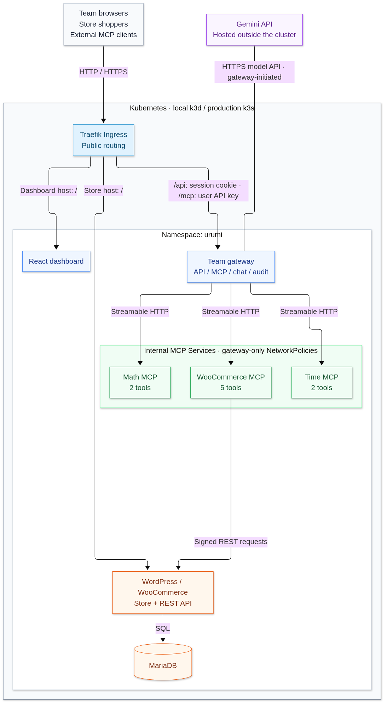

# Urumi team MCP gateway

A WooCommerce store on Kubernetes with a custom TypeScript MCP server, a team gateway, a React dashboard and Gemini-powered chat. Team members use one gateway endpoint to access WooCommerce, Time and Math. Chat runs tool calls as the signed-in user and shows attributed tool traces.

## Architecture



[Editable diagram source](docs/images/architecture.mmd)

All public application traffic enters through Ingress. Upstream MCP servers have no public route: NetworkPolicies allow only gateway Pods, and each upstream also checks its own credential. Chat executes tools through the gateway as the signed-in user; Gemini never connects directly to an upstream.

| Component | Kubernetes resources | Persistent data / credential boundary |
| --- | --- | --- |
| Dashboard | Deployment + ClusterIP Service | Static React assets; browser uses an HttpOnly session cookie for API/chat requests |
| Gateway | Deployment + ClusterIP Service + PVC | SQLite users, key hashes, sessions, registrations and audits; reads upstream tokens from Secrets; receives the Gemini key |
| WooCommerce MCP | Deployment + ClusterIP Service + NetworkPolicy | Checks its upstream bearer token; uses separate WooCommerce REST credentials from Secrets |
| Time / Math MCP | Deployments + ClusterIP Services + NetworkPolicies | Time checks a bearer token; Math checks `X-Upstream-Key`; tokens come from Secrets |
| WordPress | Deployment + ClusterIP Service + PVC | Plugins/uploads persist on the WordPress volume; database password comes from a Secret |
| MariaDB | StatefulSet + internal Service + PVC | Store database persists on its own volume; database passwords come from a Secret |

Each PVC is backed by a persistent volume. Services provide stable addresses when Kubernetes replaces Pods. External clients supply only their gateway key, and only the gateway receives the Gemini key. See [system design](docs/SYSTEM_DESIGN.md) and [credential configuration](docs/CONFIGURATION.md) for details.

| Local service | URL |
| --- | --- |
| Storefront | http://store.localhost:8080/ |
| WordPress admin | http://store.localhost:8080/wp-admin/ |
| Dashboard and chat | http://dashboard.localhost:8080/ |
| External Streamable HTTP MCP | http://localhost:8080/mcp |

## Repository layout

- `phase2/src/`: gateway/backend, custom WooCommerce MCP, Time/Math servers, Gemini chat, tests and provisioning helpers. The directory name is historical; it contains the complete application.
- `phase2/dashboard/`: React dashboard and tool-result rendering tests.
- `helm/urumi-store/`: WordPress, MariaDB, persistent storage, bootstrap and Ingress.
- `helm/urumi-platform/`: gateway, dashboard, MCP servers, storage, permissions and network isolation.
- `k3d/`: reproducible local two-node cluster configuration.
- `scripts/`: local cluster creation, private credential provisioning and store verification.

Read [system design and tradeoffs](docs/SYSTEM_DESIGN.md), [threat model](docs/THREAT_MODEL.md), [configuration](docs/CONFIGURATION.md), [testing](docs/TESTING.md) and [demo guide](docs/DEMO_GUIDE.md).

## Fresh local setup

Prerequisites: Docker Engine, k3d 5.9.0, kubectl, Helm 3, Node.js 22.19 or newer, Python 3 and access to container registries, WordPress.org and Gemini. Linux commands can also run in WSL with Docker Desktop integration.

```bash
git clone https://github.com/rohit20047/urumi.git
cd urumi
bash scripts/create-local-cluster.sh
python3 scripts/create-store-secret.py
helm upgrade --install urumi-store helm/urumi-store -n urumi \
  -f helm/urumi-store/values-local.yaml --wait --timeout=15m
npm ci --prefix phase2
npm run build --prefix phase2
node phase2/dist/provision.js
docker build -t urumi/phase2:0.2.1 phase2
docker build -t urumi/dashboard:0.2.1 phase2/dashboard
k3d image import urumi/phase2:0.2.1 urumi/dashboard:0.2.1 -c urumi-local
```

Create the Gemini Secret with a hidden prompt, then install the platform:

```bash
read -rsp 'Paste your Gemini API key: ' GEMINI_API_KEY
printf '\n'
printf '%s' "$GEMINI_API_KEY" |
  kubectl -n urumi create secret generic urumi-gemini \
    --from-file=GEMINI_API_KEY=/dev/stdin --dry-run=client -o yaml |
  kubectl apply --server-side --force-conflicts -f -
unset GEMINI_API_KEY
helm upgrade --install urumi-platform helm/urumi-platform -n urumi \
  -f helm/urumi-platform/values-local.yaml --wait --timeout=5m
```

Helpers generate random credentials once and retain them privately in `~/.config/urumi/store-credentials.json` and `~/.config/urumi/phase2-credentials.json`, outside the repository. Open those files privately to obtain the initial login credentials; do not record or commit their contents. The default WordPress username is `rohit`; the default dashboard administrator email is `rohit@example.test`. Re-running initial-admin provisioning does not reset an existing database user's password.

Chat requires a Gemini key with access/billing for the configured model. The default is `gemini-3.5-flash-lite`; set `chat.model`, `chat.timezone` and `chat.existingSecret` through Helm values. To install before supplying Gemini, add `--set chat.enabled=false`. After changing an environment-backed Secret, restart its consumer Deployment. The model key is never included in the frontend bundle.

## Store, team and chat

1. Open the store, add a product to cart and complete checkout using fictional details and Cash on delivery. Confirm the order under WooCommerce → Orders in WordPress admin. No online payment or real delivery is arranged by this test store.
2. Sign in to the dashboard as admin. WooCommerce, Time and Math are pre-registered with nine tools in total. Admins manage servers, invitations, API keys and audits. Members use tools and manage their own API keys.
3. Invite a second user under Team. Share the single-use invitation link privately; it expires after 24 hours. Use a separate browser profile/session for that user's login.
4. Open Chat and ask “Create a product named Demo Mug priced at 199 INR,” then purchase it manually. Ask “Use Time and WooCommerce to list today's orders in Asia/Kolkata.” Check tool traces and Activity attribution.

Members share the enabled tools' privileges, including store writes. Revoking an API key blocks that credential on its next request; it does not suspend the account or end its separate browser session. Server/tool lists and audits have a Refresh button. Chat history is temporary and resets on reload, backend restart or idle expiry. Check Activity/store state before retrying a write after a lost reply.

## External MCP client

Generate a user API key in the dashboard and configure a local Claude Code, Cursor or MCP Inspector client:

- Transport: Streamable HTTP.
- URL: `http://localhost:8080/mcp`.
- Header: `Authorization: Bearer <your gateway API key>`.

Only the gateway URL and user key are needed; upstream credentials remain server-side. A remotely hosted client cannot reach this computer's localhost. A normal browser GET to `/mcp` returns 405 because this endpoint accepts MCP POST requests.

For the official Inspector CLI:

```bash
read -rsp 'Paste your gateway API key: ' URUMI_KEY
printf '\n'
npx --yes @modelcontextprotocol/inspector@2.12.0 --cli \
  http://localhost:8080/mcp --transport http --method tools/list \
  --format json --header "Authorization: Bearer $URUMI_KEY"
npx --yes @modelcontextprotocol/inspector@2.12.0 --cli \
  http://localhost:8080/mcp --transport http --method tools/call \
  --tool-name woocommerce__list_orders --tool-args-json '{"per_page":10}' \
  --format json --header "Authorization: Bearer $URUMI_KEY"
unset URUMI_KEY
```

Inspector lists/calls MCP tools; a natural-language prompt also needs an LLM agent. The acceptance harness supplies a Gemini agent whose tool calls run through the official Inspector CLI. See [testing](docs/TESTING.md) for the distinction and two-user flow.

## Local networking and storage

Browsers resolve `.localhost` to loopback. k3d maps host `127.0.0.1:8080` to its load balancer; Traefik routes by Ingress hostname. No hosts-file change is required. For clients without wildcard-localhost resolution, use `curl --resolve store.localhost:8080:127.0.0.1 http://store.localhost:8080/`.

The cluster has one tainted control-plane node and one worker. WordPress content, MariaDB and gateway SQLite use separate retained PVCs on the worker. Stop/start preserves them; deleting the cluster or worker can lose local data. The local WordPress callback override maps its own exact HTTP `.localhost` origin to the correct Pod port for WP-Cron/Action Scheduler; production disables it.

```bash
kubectl -n urumi get pods,pvc,svc,ingress,networkpolicy
k3d cluster stop urumi-local
k3d cluster start urumi-local
```

## Verification

```bash
npm ci --prefix phase2
npm run build --prefix phase2
npm test --prefix phase2
npm ci --prefix phase2/dashboard
npm test --prefix phase2/dashboard
npm run build --prefix phase2/dashboard
helm lint helm/urumi-store -f helm/urumi-store/values-local.yaml
helm lint helm/urumi-store -f helm/urumi-store/values-prod.yaml
helm lint helm/urumi-platform -f helm/urumi-platform/values-local.yaml
helm lint helm/urumi-platform -f helm/urumi-platform/values-prod.yaml
```

See [the complete test flow](docs/TESTING.md) for live tests. They create fictional data and temporarily disrupt services, so run them sequentially against a test cluster. The core suite uses a recent checkout order by default; set `VERIFY_ORDER_ID` to choose an existing test order explicitly. The Gemini acceptance suite requires a same-day manual checkout and incurs model usage.

The mandatory core was exercised on 24 October 2026: 15 backend tests, 15 dashboard tests, 11 core live groups, four naming groups, seven resilience groups and eight real Gemini/two-user Inspector groups passed. The fresh flow created a product through chat, checked it out manually, confirmed its admin order and retrieved it through both users. No optional differentiator, live VPS deployment or completed final video is claimed.

## Production-like VPS

Use the same charts on a Linux VPS with k3s, Helm, persistent disk, DNS and sufficient resources. Publish both images to your registry. Copy the supplied production values into private deployment values and configure image paths, domains, TLS Secret names, HTTPS origins/MCP/store URLs and storage class/capacities.

Create the target namespace and provision the [documented Secrets](docs/CONFIGURATION.md) separately using new production credentials. WooCommerce REST credentials must match the target store. Supply the TLS Secrets referenced by the values. Expose intended Ingress ports, retain internal Services/network isolation and allow outbound HTTPS required by Gemini and provisioning.

```bash
helm upgrade --install urumi-store helm/urumi-store -n urumi \
  -f /private/store-values-prod.yaml --wait --timeout=15m
helm upgrade --install urumi-platform helm/urumi-platform -n urumi \
  -f /private/platform-values-prod.yaml --wait --timeout=5m
```

Production values enable Secure cookies, disable local callback routing and use production hostnames. Charts were linted/rendered for production; a live VPS deployment has not been performed. Single-replica SQLite, worker-local storage and gateway namespace Secret permissions are documented limitations.

## Backups, upgrades and rollback

Back up MariaDB, WordPress content, gateway SQLite and matching Secrets outside the repository before upgrades. Use a consistent SQLite backup API/VACUUM INTO or stop writes; copying only a live WAL-mode database file is insufficient.

```bash
helm history urumi-store -n urumi
helm history urumi-platform -n urumi
helm upgrade urumi-platform helm/urumi-platform -n urumi \
  -f helm/urumi-platform/values-local.yaml --wait --timeout=5m
helm rollback urumi-platform PREVIOUS_REVISION -n urumi --wait --timeout=5m
```

Select an actual previous revision. Helm rollback restores manifests, not database transactions, WordPress files or incompatible schema changes. Retained PVCs are not a backup against cluster/namespace deletion.
